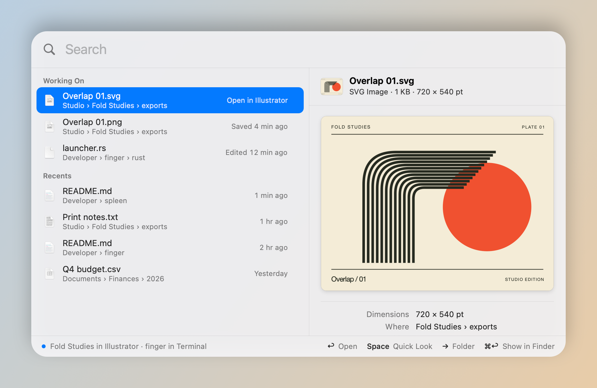
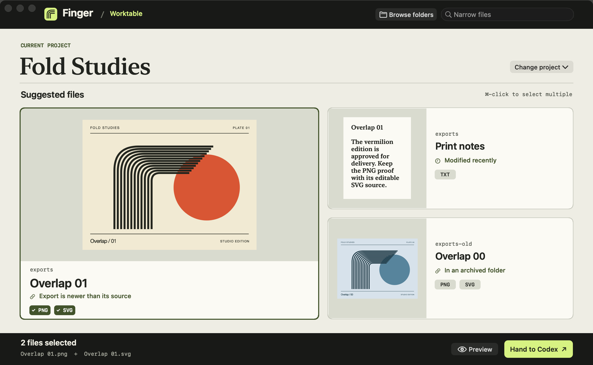
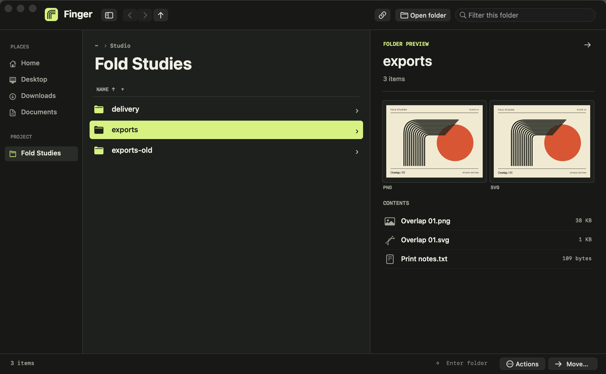
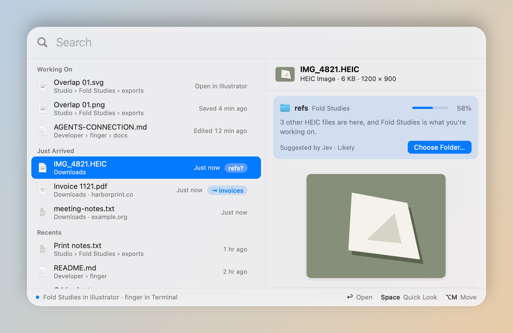

# Finger

Finger is a native Mac file finder that knows what you're working on. Press **⌃Space** from any app for its search panel. The panel lists the files and projects you're busy with and previews them. With a Jev key, it also suggests where new downloads belong.



Its window opens to a worktable with visual previews of files from your current project. It uses recent activity, matching sources and exports, and changes since your previous visit to decide what to show. Select a file to preview it or bring it into Codex.

## Launch

Finger runs on macOS 14 or later and has been tested on Apple silicon. Build it from the project folder, then open it. Building needs [Rust](https://rustup.rs/) and the Xcode command-line tools. [Build and package](#build-and-package) has the details.

```sh
./scripts/build.sh
open build/Finger.app
```

Choose **Change project** to use your own folder. **Browse folders** (**⌘2**) opens the file browser, and **Worktable** (**⌘1**) brings you back.



You can also drop a folder onto the app icon, or open a group of files with `open -a /path/to/Finger.app`. Files from one folder arrive selected together. Files from different folders open as a collection.

## Search panel and everyday install

Press **⌃Space** from any app for Finger's search panel: type to find a file or folder, **↩** to open it or step in, **⌫** to go back up, and **esc** to close. **Finger → Panel Shortcut…** (also in the menu bar item) changes the shortcut.

**Working On** at the top of Home lists the files or projects you are busy with, each with a short reason such as "Edited 12 min ago". Blue dots mark the folders that lead there, so entering a folder lands on the trail after where you left off, and the folder preview says why it matters. The footer names your top projects. Click it to see what Finger knows. Finger works this out on your Mac from Spotlight's recently used files, saves in your home folder, the app in front, the folders your shells and Claude Code or Codex sessions are in (read from their running processes), and git. Working On sends none of this anywhere. It runs `git status` only in repositories whose own config can't make git run a program, so a repo that arrives in a zip can't run code through Finger. **Use Activity** in the menu bar item turns this off and forgets what was collected. Separately, Finger's preferences keep your recent folders, recently opened files, project visits and past moves, so it can suggest destinations. Use Activity doesn't clear those. **Use App Documents…** adds the front window's document and asks for Accessibility. `./scripts/awareness-probe.sh` prints what Finger would show right now, without changing anything.

To keep Finger running in the background with Open at Login, install it from the project folder:

```sh
./scripts/install.sh
```

It builds the app, quits the running copy, replaces **/Applications/Finger.app**, adds a LaunchAgent at **~/Library/LaunchAgents/com.d4j3y2k.Finger.plist** that starts Finger with `--background` at login, and starts it now. Run it again after any change. Finger then has a menu bar item and shows a Dock icon only while its window is open; closing the window leaves ⌃Space working. Use **Quit Finger** in the menu bar item to stop it.

Turn Open at Login off with the menu bar item's **Open at Login**, or from Terminal:

```sh
/Applications/Finger.app/Contents/MacOS/Finger --login-item off
```

## A one-minute practice run

**File → Open Practice Project** opens a fresh, writable copy of **Fold Studies** on the Worktable.

1. Find **Overlap 01**. Its card pairs the PNG export with the editable SVG. Type **Overlap 01** to narrow the worktable to that study.
2. Click **PNG**, then **Preview** or **Space**. Press **Escape** to close Quick Look. Click **SVG** to select the source on its own.
3. Click the card to select both files, then choose **Hand to Codex**. A new Codex draft contains both paths, ready for your instructions. If the desktop app is unavailable, Finger copies the selection for you to paste.
4. Choose **Browse folders** to explore the project. Open **exports** to see the original files, or **exports-old** for the earlier blue print. Press **⌘1** to return to the Worktable.

## Folder browsing and file operations

Select a folder to see a contact sheet and filenames. Press **→** to enter it, or click a thumbnail to enter with that file selected. In the practice project, you can Command-click the PNG and SVG in **exports**, choose **Move…**, then choose **delivery**. **Edit → Undo Move** puts them back.



| Action | Shortcut |
| --- | --- |
| Select, extend a range, select discontiguous rows | ↑ / ↓, Shift–arrow, Command–click |
| Enter a folder, visit its parent | →, ← |
| Open in the default app | Return or double-click |
| Back, Forward | ⌘[, ⌘] or horizontal trackpad swipe |
| Filter the current folder by name | Type, or ⌘F |
| Clear the filter and restore the earlier selection | Escape |
| Find a filename in subfolders | ⇧⌘F |
| Quick Look, then browse adjacent items | Space, then ↑ / ↓ |
| New folder, rename | ⇧⌘N, F2 or ⌘Return |
| Copy or move to a chosen folder | ⇧⌘C, ⇧⌘M |
| Copy, cut, paste files | ⌘C, ⌘X, ⌘V |
| Move copied files here | ⌥⌘V |
| Undo or redo a move or rename | ⌘Z, ⇧⌘Z |
| Show hidden files, refresh | ⇧⌘., ⌘R |

Drag a file onto a folder row or sidebar location to move it inside Finger. Hold Option to copy. Drag the divider to change how much room filenames and previews receive. The sidebar becomes a locations menu in narrow windows. Click a breadcrumb to visit an ancestor.

With several files selected, **Space** opens Quick Look and **↑ / ↓** walks just those files. **Escape** leaves the whole group selected for a move or copy.

A folder preview stays current when an exporter writes new files into it. Drag a preview thumbnail or filename straight onto a neighboring folder, or click it to enter with that item selected. The list header and **View → Sort By** offer name, modification date and size in either direction. The folder preview follows the same order. Collections keep their saved order.

Move and Copy suggest real folders in the current project first. **Keep Both** creates a unique name for the incoming item. Each successful move or rename has an in-session undo receipt. Finger checks the live item before applying it and reports conflicts. Quick Look, folder browsing, filename search and local destination suggestions work offline.

## Agent collections

Each build configures Codex and Claude Code for this checkout. Select files on the Worktable or in the file browser and ask the connected agent to make a named collection from the selection. Collections open in the same window. Each row shows its original folder so identically named files are distinguishable. Right-click a collection to rename or remove it.

**Help → Agent Connection** gives registration commands for the running bundle. The connection guide includes exact project settings, setup from other directories, Claude Desktop instructions and how it was tested. [Agent connection guide](docs/AGENTS-CONNECTION.md)

## Optional Jev ranking and filing

Finger can ask Jev, a model from TypeSafe, where files belong. It does so only when it has a TypeSafe key. Add one with **Jev API Key…** in the menu bar item, which stores it in your login Keychain, or set `FINGER_JEV_API_KEY` or `TYPESAFE_API_KEY` in the app's environment. Without a key, Finger sends nothing over the network.



With a key, Finger sends these to TypeSafe:

- **When you click Rank with Jev** in the destination sheet: the selected files' names and the candidate folders' names.
- **Automatically, for each new download in Downloads**: the file's name, the website it came from (the host only, such as `example.com`), and up to 10 candidate folder names, each with its parent folder's name. Candidates can come from your recent projects. Nothing moves until you confirm it.

File contents and full paths are never sent, and your home folder is sent as "Home". Remove the key to stop both. A `TYPESAFE_API_KEY` you set for another tool also turns this on if you start Finger from that shell. To start Finger with a key from your environment, quit any open copy and run the executable from your configured shell.

```sh
./build/Finger.app/Contents/MacOS/Finger
```

## Build and package

The source build uses a stable Rust toolchain with Cargo, Xcode command-line tools with a macOS SDK, and Python 3 for assembly. If `cargo` isn't on your PATH, install Rust with [rustup](https://rustup.rs/).

From the project folder:

```sh
./scripts/build.sh
open build/Finger.app
```

`Cargo.lock` pins the Rust dependencies. The Swift AppKit adapter uses system frameworks. The resulting bundle contains the Rust executable, native interface library, practice artwork, icon and MCP bridge. Running it requires no compiler, account or separately installed service.

Finger is built and tested with Rust 1.100.0 and Apple Swift 6.3.3 on the macOS 26.5 SDK. The deployment target is macOS 14.0.

```sh
./scripts/package.sh
```

The packaging script verifies the ad-hoc signature, extracts the archive, and verifies the extracted app. It writes **build/Finger-macOS-arm64.zip** on Apple silicon. This build targets macOS 14 or later and was exercised on Apple silicon with macOS 26.5.2. It hasn't been tested on Intel Macs. The app is ad-hoc signed, not notarized, so Gatekeeper blocks a copy downloaded from the internet. Build it on the Mac that will run it.

## Reproduce the checks

Run the checks from a logged-in macOS desktop. The script builds the app and runs the Rust filesystem tests. It then checks the Find sheet, destination ranking, background mode, the panel shortcut, the search panel, Jev filing, Working On, file previews and the MCP bridge, and runs the native window against 10,000 real entries. The panel and preview checks leave light and dark PNGs in `build/` to look over.

```sh
./scripts/check.sh
```

For detailed filesystem and whole-window performance measurements, run the following after the checks.

```sh
source scripts/rust-env.sh
python3 tests/benchmark_core.py
python3 tests/gui-bench/run.py --entries 10000 100000 --samples 9 --compare --compare-index --profile
```

The GUI benchmark opens a separate AppKit window with isolated preferences and creates its own real mixed-file directories. The cross-volume suite creates temporary APFS and exFAT disk images, exercises transfers and recovery, and ejects the images.

```sh
python3 tests/cross_volume.py
python3 tests/gui-bench/run.py --volume-recovery
python3 -B tests/termination/run.py
```

The termination suite requests Quit while a real copy is in flight and verifies the published files after the app exits. It also exercises a collision that needs a decision before quitting.

The performance report records the hardware, data, measurement boundary and before/after timings. [Performance measurements](docs/PERFORMANCE.md)

## License

Finger is released under the [MIT License](LICENSE).
